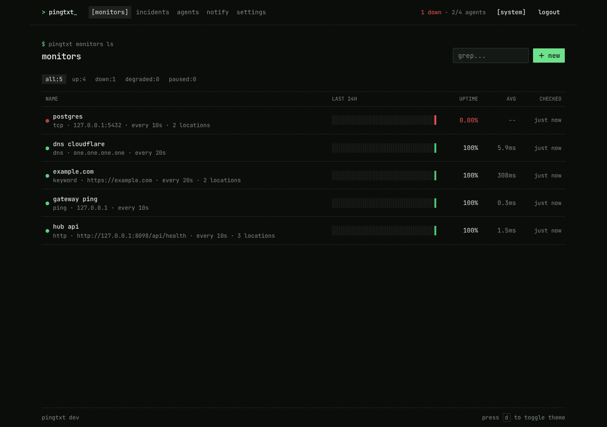
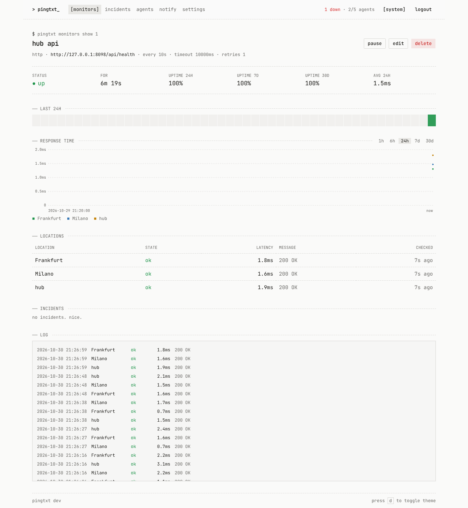

# pingtxt

Minimal, terminal-flavoured uptime monitoring that you host yourself. Think Uptime Kuma / UptimeRobot /
HetrixTools, but plain text, monospace, light and dark. Website and docs: [pingtxt.com](https://pingtxt.com).

| dark | light |
| --- | --- |
|  |  |

- **One container** for the hub: Go API, scheduler, SQLite (or PostgreSQL / MariaDB) and the web UI.
- **Agents** for checks from many places: a ~8 MB static binary or Docker image that only dials *out* to the hub.
  No open ports, works behind NAT, updates itself. A monitor is down when more than half of its locations fail.
- **Checks**: HTTP(S) with JSON rules, timing per phase and steps (log in, then check), keyword, TCP, UDP,
  WebSocket, ping, DNS, PostgreSQL, MySQL/MariaDB, Redis, MongoDB, Docker containers, gRPC, SMTP, MCP servers and
  heartbeats for cron jobs. IPv6 everywhere.
- **Status**: up, degraded (some locations fail or answer too slowly) or down; uptime that follows it; diagnostics
  (DNS, TCP, TLS, headers, traceroute) collected at the first failure.
- **Alerts**: email (SMTP or Resend), Slack, Discord, Microsoft Teams, Telegram, Matrix, ntfy, Gotify, Pushover,
  PagerDuty, Opsgenie, SMS (Twilio), webhooks and the iOS app, with escalation, reminders, maintenance windows,
  certificate and domain expiry, agent offline alerts and weekly reports.
- **Status pages** on your own domain, with incidents, email subscribers, password protection and badges.
- **Teams**: admin and read-only users, GitHub / Google / OpenID Connect login, two-factor authentication, audit log.
- **Integrations**: REST API with tokens, an MCP server for Claude and other AI assistants, Prometheus metrics,
  backups and configuration export/import.

## Quick start

```sh
docker run -d --name pingtxt --restart unless-stopped \
  -p 8090:8090 -v ./data:/data \
  ghcr.io/federico-it/pingtxt:latest
```

Open `http://localhost:8090`, create the admin account and add a monitor. Everything else is configured from the
web UI. Or use the [docker-compose.yml](docker-compose.yml) of this repository.

## Documentation

The docs are in [`docs/`](docs/) ([English](docs/en/README.md), [italiano](docs/it/README.md)) and on
[pingtxt.com/docs](https://pingtxt.com/docs/).

| | |
| --- | --- |
| [Concepts](docs/en/concepts.md) | hub, locations, statuses, incidents, uptime |
| [Install](docs/en/install.md) | Docker, configuration, PostgreSQL or MariaDB, reverse proxy, IPv6, without Docker |
| [Locations (agents)](docs/en/locations.md) | add an agent, offline alerts, agent updates |
| [Monitors](docs/en/monitors.md) | check types, JSON rules, slow threshold, groups and tags, diagnostics |
| [Alerts and notifications](docs/en/alerts.md) | channels, events, escalation, maintenance, expiry alerts, reports |
| [Status pages](docs/en/status-pages.md) | custom domain, password, incidents and subscribers, badges |
| [iOS app](docs/en/ios-app.md) | push notifications and their actions, Live Activity |
| [Users and security](docs/en/security.md) | roles, single sign-on, two-factor authentication, audit log |
| [Integrations](docs/en/integrations.md) | API tokens, MCP server, Prometheus |
| [Administration](docs/en/administration.md) | upgrades, backups, export and import, usage stats, verifying releases |
| [REST API reference](https://pingtxt.com/docs/api/) | every endpoint, also served by each hub at `/api/docs` |

## Related repositories

- [pingtxt-push-relay](https://github.com/federico-it/pingtxt-push-relay): forwards hub alerts to the iOS app.
- [pingtxt-telemetry](https://github.com/federico-it/pingtxt-telemetry): the opt-in anonymous usage stats.

## Contributing

Contributions are welcome. [CONTRIBUTING.md](CONTRIBUTING.md) covers the dev setup, building from source, the
project layout, writing docs and how pull requests get merged.

- **Bugs**: open a [bug report](https://github.com/federico-it/pingtxt/issues/new?template=bug_report.yml).
- **Ideas**: open a [feature request](https://github.com/federico-it/pingtxt/issues/new?template=feature_request.yml);
  for bigger changes, agree on the approach in an issue before writing code.
- **Security problems**: report them privately as described in [SECURITY.md](SECURITY.md), never in a public issue.

Everyone taking part follows the [code of conduct](CODE_OF_CONDUCT.md).

## License

Copyright (C) 2026 Federico Mengascini and pingtxt contributors.

pingtxt is free software, licensed under the [GNU Affero General Public License v3.0](LICENSE) (AGPL-3.0).
You can use it for anything, including commercially, self-host it and modify it. If you distribute a modified
version, or run one as a service that other people use over a network, you must publish its source code under
the same license.
